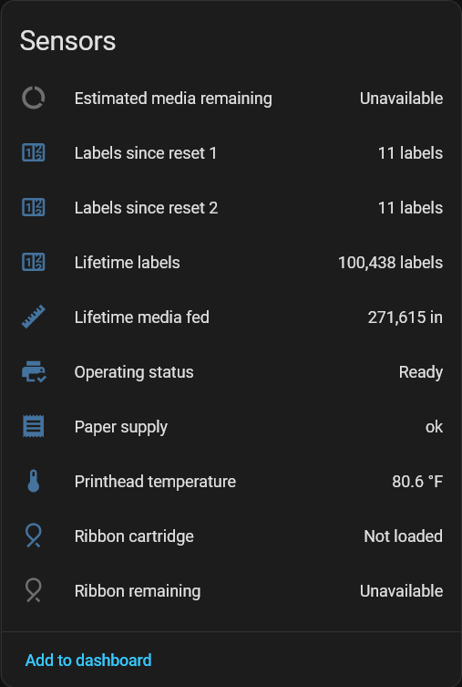
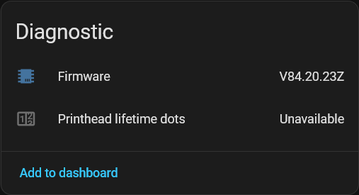
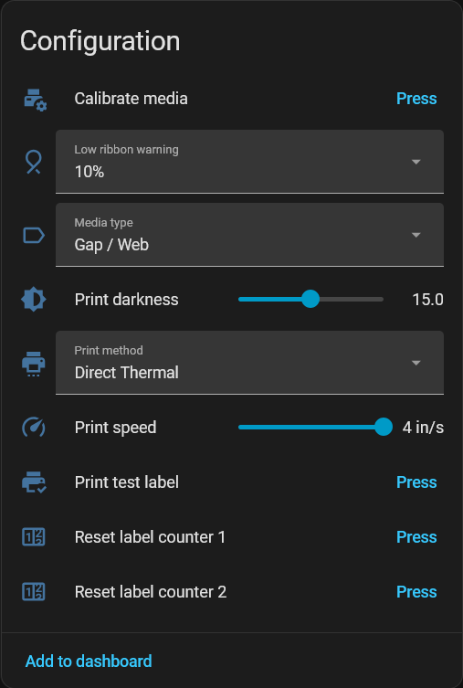
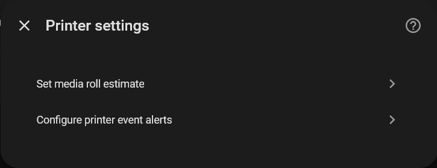
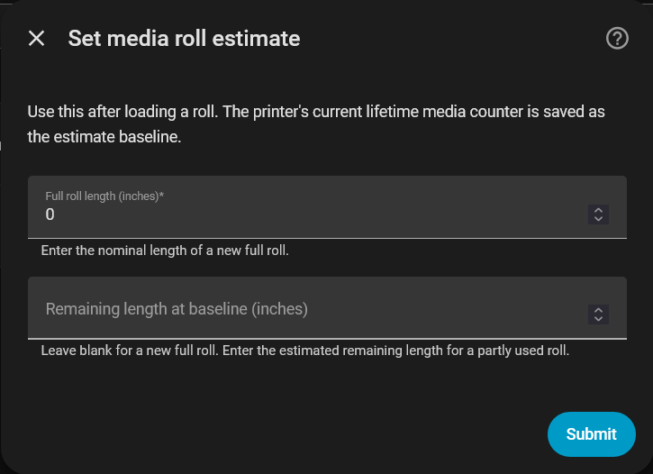
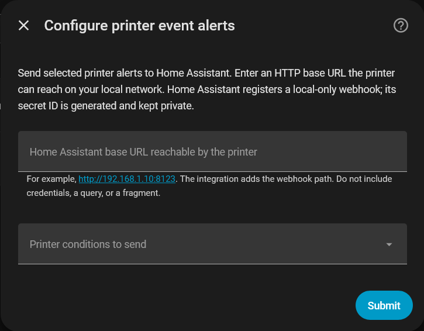

# Zebra Printer for Home Assistant

<p align="center">
  
</p>

<p align="center">
  Monitor a networked Zebra label printer, manage print settings and label counters, and send raw ZPL from Home Assistant.<br>
  The integration connects locally over the printer's raw TCP port using Zebra Set-Get-Do (SGD) commands.
</p>

<p align="center">
  <a href="https://my.home-assistant.io/redirect/hacs_repository/?owner=Nischay-Pro&amp;repository=ha-zebra&amp;category=integration">
    
  </a>
</p>

<p align="center">
  <strong>Quick start</strong><br>
  <a href="#1-installation">Installation</a> ·
  <a href="#2-getting-started">Setup</a> ·
  <a href="#supported-devices">Supported devices</a> ·
  <a href="#3-entities">Entities</a> ·
  <a href="#4-printing-labels">Printing</a>
</p>

<p align="center">
  <strong>Reference</strong><br>
  <a href="#5-media-roll-estimate">Media roll estimate</a> ·
  <a href="#6-dashboard-controls">Dashboard controls</a> ·
  <a href="#7-printer-event-alerts">Printer alerts</a> ·
  <a href="#example-automations">Automation examples</a> ·
  <a href="#8-troubleshooting">Troubleshooting</a> ·
  <a href="#9-development">Development</a> ·
  <a href="#about-this-integration">About</a>
</p>

## Supported devices

| Manufacturer | Model | Supported | Notes |
| --- | --- | :---: | --- |
| Zebra | ZD420 | ✅ | Fully supported |

> ⚠️ Other models are not confirmed as fully supported. If an unlisted Zebra
> printer works without issues, [report its model and firmware](https://github.com/Nischay-Pro/ha-zebra/issues/new?template=device_compatibility.yml)
> so we can consider adding it to this list.

Different models may expose different SGD settings or counters. Print jobs are
sent as raw ZPL over the local TCP port.

## Features

- **Live operating status:** decodes Zebra's pause, error, and warning flags,
  including media/ribbon faults, open printhead, temperature faults, and media
  calibration warnings. Simultaneous conditions appear as sensor attributes.
- **Printer statistics:** lifetime and resettable label counts, total media
  fed, estimated media remaining, printhead lifetime usage, firmware, and
  printhead temperature.
- **Media status:** ribbon cartridge status and remaining length, low-ribbon
  warning threshold, and paper-supply values reported by the printer.
- **Print controls:** print method, darkness, speed, and media type; resettable
  counter buttons; media calibration and a one-label test print; and raw ZPL
  through the `zebra_printer.print` action.
- **Home Assistant device:** one device per configured printer, with a link to
  its web configuration page and included icon and logo assets.
- **Automatic discovery:** searches for Zebra printers when the setup flow
  opens, with manual host and port entry as a fallback.
- **Local polling:** reads the printer every 60 seconds; no cloud account is
  required.
- **Optional printer alerts:** selected printer conditions can be sent to a
  local-only Home Assistant webhook when the printer reports HTTP-POST alert
  support.

> [!NOTE]
> The lifetime label count cannot be reset; each reset button affects only its
> matching resettable counter.

## 1. Installation

### HACS

1. In HACS, search for **Zebra Printer** and install it.
2. Restart Home Assistant.

If **Zebra Printer** does not appear in the search results, add the repository
as a custom repository:

1. In HACS, open the menu and choose **Custom repositories**.
2. Enter `https://github.com/Nischay-Pro/ha-zebra` and choose
   **Integration** as the category.
3. Add the repository, then search for **Zebra Printer** and install it.
4. Restart Home Assistant.

### Manual

Copy `custom_components/zebra_printer` into
`/config/custom_components/zebra_printer` on your Home Assistant system, then
restart Home Assistant.

## 2. Getting started

Go to **Settings → Devices & services → Add integration → Zebra Printer**.
The setup flow searches enabled Home Assistant IPv4 networks using Zebra's UDP
network-discovery service on port 4201. Select a verified printer from the
results, or choose **Search again** to repeat the scan. If discovery has no
results, the form also lets you retry or enter the printer's hostname or IP
address and raw TCP print port (usually `9100`). The flow checks the printer's
SGD response before creating the device. Discovery requires local broadcast
traffic between Home Assistant and the printer. A bind or network-interface
error is shown separately from a scan where no printer replied.

To change a configured printer's host or port, open its config entry and choose
**Reconfigure**. The flow checks the printer's required SGD settings before it
saves the new address. If the printer reports `device.unique_id`, the
integration uses it for config-entry and device identity, migrating an older
host-based identity while keeping the existing device and entity IDs. Printers
that do not report this variable continue using the host as their identity.

Open the new Zebra device page to see its entities. The integration supplies
local PNG branding for Home Assistant versions that support it. The device page
also links to the printer's own web configuration page.

| Setting | What to enter |
| --- | --- |
| Host | Printer hostname or IP address, without `http://` |
| Port | Raw TCP print port; default `9100` |

The printer's web page may ask for an administrator password. This integration
does not use that password: it talks to the raw TCP SGD port. Whether setting
changes are allowed depends on the printer's security configuration. A change
is reported as successful only after the printer confirms its new value.

## 3. Entities

| Entity | Description |
| --- | --- |
| Operating status | Printer-reported state; attributes list all active errors and warnings |
| Lifetime labels | Nonresettable number of labels printed |
| Labels since reset 1 / 2 | The two resettable label counters |
| Lifetime media fed | Total media length fed through the printer, in inches |
| Estimated media remaining | Approximate remaining length from a configured roll and the lifetime media-fed counter |
| Firmware | Printer firmware version |
| Printhead temperature | Current printhead temperature |
| Printhead lifetime usage | Lifetime count of dots printed by the printhead |
| Ribbon cartridge | Whether a ribbon cartridge is loaded |
| Ribbon remaining | Remaining cartridge ribbon length in meters |
| Low ribbon warning | Select the cartridge's warning threshold |
| Paper supply | Printer-reported media status |
| Print method | Select Direct Thermal or Thermal Transfer |
| Print darkness | Set darkness from 0.0 to 30.0 |
| Print speed | Set speed within the ZD420's resolution-specific range |
| Media type | Select continuous, gap/web, or mark/notch media |
| Reset label counter 1 | Set resettable counter 1 to zero |
| Reset label counter 2 | Set resettable counter 2 to zero |
| Calibrate media | Run media and ribbon sensor calibration |
| Print test label | Print one diagnostic label |

<p align="center">
  <a href="docs/images/device-sensors.png"></a>
</p>
<p align="center"><em>Live printer readings appear in the Sensors card.</em></p>

Thermal Transfer selection requires the printer to report an inserted ribbon
cartridge. Use appropriate thermal-transfer media as well. Each reset button
changes only its corresponding resettable counter; neither affects lifetime
labels or the other resettable counter. Optional controls become available
when their printer readings support them.

Firmware and printhead lifetime usage appear in a separate Diagnostic card when
the printer reports those values.

<p align="center">
  <a href="docs/images/device-diagnostics.png"></a>
</p>
<p align="center"><em>The Diagnostic card shows firmware and printhead usage when available.</em></p>

## 4. Printing labels

Use the `zebra_printer.print` action and select one configured Zebra Printer
device. The `zpl` field accepts raw ZPL text encoded as UTF-8. The integration
sends it as supplied without checking its size or ZPL syntax. This example
sends one label:

```yaml
action: zebra_printer.print
data:
  device_id: YOUR_ZEBRA_DEVICE_ID
  zpl: |-
    ^XA
    ^FO40,40^A0N,40,40^FDHello from Home Assistant^FS
    ^XZ
```

The action sends the supplied bytes once and does not retry. Zebra printers do
not acknowledge that the label was physically printed, so a successful action
only confirms that Home Assistant handed the data to the TCP connection. If a
connection fails during transmission, some or all of the job may have reached
the printer; check the printer before manually retrying to avoid duplicate
labels. For non-ASCII text, use a matching Zebra character encoding command
such as `^CI28` in the ZPL.

### Calibration, test label, and print settings

The **Calibrate media** button runs Zebra's manual calibration for the media
and ribbon sensors. Calibration can feed media. The **Print test label** button
sends one small diagnostic label and consumes media.

The print darkness control uses Zebra's 0.0–30.0 range. Print speed is limited
by the ZD420 printhead resolution: 2–6 ips at 203 dpi and 2–4 ips at 300 dpi.
The media type selector offers continuous, gap/web, and mark/notch. These
settings change printer behavior and can affect label quality or feed
registration; use values appropriate for the loaded media.

<p align="center">
  <a href="docs/images/device-controls.png"></a>
</p>
<p align="center"><em>Print settings, calibration, test printing, and counter resets are available on the device page.</em></p>

## 5. Media roll estimate

After loading a roll, open **Settings → Devices & services**, select the Zebra
Printer entry, choose **Configure**, then **Set media roll estimate**.

<p align="center">
  <a href="docs/images/printer-settings.png"></a>
</p>
<p align="center"><em>Open this menu to configure a media estimate or printer event alerts.</em></p>

Enter the roll's full nominal length in inches. Leave the remaining length
blank for a new full roll; for a partly used roll, enter the estimated media
remaining. Saving refreshes the printer's lifetime media-fed counter and uses
that reading as the new estimate baseline.

<p align="center">
  <a href="docs/images/media-roll-estimate.png"></a>
</p>
<p align="center"><em>Enter the roll's nominal length and, for a partly used roll, its remaining length.</em></p>

The `zebra_printer.set_media_roll` action is also available for automations:

```yaml
action: zebra_printer.set_media_roll
data:
  device_id: YOUR_ZEBRA_DEVICE_ID
  roll_length_inches: 1000
```

The sensor estimates remaining media as the configured starting remainder minus
additional media fed by the printer, and clamps the result to zero. The printer
does not directly measure roll length. This estimate can drift because the
counter includes media used for calibration, test labels, and waste, and it may
not account for media removed outside the printer. If the lifetime counter
drops below the saved baseline, the sensor becomes unavailable. Use **Set media
roll estimate** again to establish a new baseline.

## 6. Dashboard controls

Add the **Print method** select entity to an Entities card, or use a Tile card
with the **Select options** feature.

For the reset button, a confirmation on the dashboard helps prevent accidental
presses. This example uses the entity ID from a ZD420; replace it if Home
Assistant assigned a different ID:

```yaml
type: button
entity: button.zebra_zd420_reset_label_counter_1
name: Reset label counter 1
tap_action:
  action: perform-action
  perform_action: button.press
  target:
    entity_id: button.zebra_zd420_reset_label_counter_1
  confirmation:
    text: Reset label counter 1 to zero? Lifetime labels will not change.
```

Use the matching entity ID to reset counter 2:

```yaml
type: button
entity: button.zebra_zd420_reset_label_counter_2
name: Reset label counter 2
tap_action:
  action: perform-action
  perform_action: button.press
  target:
    entity_id: button.zebra_zd420_reset_label_counter_2
  confirmation:
    text: Reset label counter 2 to zero? Lifetime labels will not change.
```

The confirmation applies to each card. A direct `button.press` service call
does not show a confirmation.

## 7. Printer event alerts

Printer-originated alerts are disabled by default. Open the Zebra Printer
config entry and choose **Configure** to enable them. Select the conditions to
forward and enter an HTTP base URL that the printer can reach, such as
`http://192.168.1.10:8123`. The integration generates a webhook ID with Home
Assistant and builds the callback URL by appending Home Assistant's webhook
path. The webhook accepts local-network POST requests only.

<p align="center">
  <a href="docs/images/printer-event-alerts.png"></a>
</p>
<p align="center"><em>Choose a reachable Home Assistant URL and the printer conditions to forward.</em></p>

The setup checks that the printer reports both the selected conditions through
`alerts.conditions` and the `HTTP-POST` destination through
`alerts.destinations`. The integration then configures both condition-set and
condition-clear alerts. It checks the callback's printer identity against
`device.unique_id` when the printer reports that value. For each matching
callback it fires the
`zebra_printer_alert` event with `config_entry_id`, `condition`, and the
printer's `message`. Automations can filter on the event type and condition.
Only the selected, printer-reported conditions are forwarded.

Use an HTTP address on the same network the printer can reach. The callback
must reach Home Assistant directly enough to be recognized as local; a public
or cloud-only address is not suitable for this local-only webhook. Do not share
the generated webhook ID. Disabling alerts, unloading the entry, or deleting
it sends Zebra's documented remove command for these exact conditions and
callback URL. If Home Assistant cannot connect to the printer during cleanup,
the printer may retain a rule pointing to the retired webhook. The integration
does not retain failed cleanup data for an automatic retry; remove a stale rule
through the printer configuration after reconnecting.

Zebra references: [HTTP POST alert payload](https://docs.zebra.com/us/en/printers/software/zpl-pg/http-post-alerts/configuring-alerts-where-the-alert-destination-is-http-post.html), [alerts.add and rule removal](https://docs.zebra.com/content/tcm/us/en/printers/software/zpl-pg/sgd-command-reference/alerts-add.html), and [available alert conditions](https://docs.zebra.com/content/tcm/us/en/printers/software/zpl-pg/sgd-command-reference/alerts-conditions.html).

## Example automations

Replace `notify.mobile_app_your_phone` and any example entity or device IDs
with the names from your Home Assistant instance.

### Notify when the printer reports that paper is out

Enable printer event alerts in the integration options and select **PAPER OUT**.
This automation uses the printer alert event and its reported message:

```yaml
alias: Notify when the Zebra printer runs out of paper
triggers:
  - trigger: event
    event_type: zebra_printer_alert
    event_data:
      condition: PAPER OUT
actions:
  - action: notify.mobile_app_your_phone
    data:
      title: Zebra printer
      message: "{{ trigger.event.data.message }}"
mode: queued
```

### Notify when the media roll is low

Configure the media roll estimate first. This example notifies when the
estimated remaining length crosses below 100 inches. Replace the entity ID if
Home Assistant assigned a different one:

```yaml
alias: Notify when Zebra media is low
triggers:
  - trigger: numeric_state
    entity_id: sensor.zebra_zd420_estimated_media_remaining
    below: 100
actions:
  - action: notify.mobile_app_your_phone
    data:
      title: Zebra printer
      message: >-
        About {{ states('sensor.zebra_zd420_estimated_media_remaining') }} in
        of media remain.
mode: single
```

### Print a label when a helper is pressed

Create an Input button helper named `print_pickup_label` (or change the entity
ID below). Replace `YOUR_ZEBRA_DEVICE_ID` with the printer's device ID:

```yaml
alias: Print a pickup label
triggers:
  - trigger: state
    entity_id: input_button.print_pickup_label
actions:
  - action: zebra_printer.print
    data:
      device_id: YOUR_ZEBRA_DEVICE_ID
      zpl: |-
        ^XA
        ^FO40,40^A0N,36,36^FDPackage ready for pickup^FS
        ^XZ
mode: single
```

The print action sends the ZPL once; it does not confirm that a label was
physically printed. See [Printing labels](#4-printing-labels) before adding
automatic retries, since an interrupted connection may still have delivered
some or all of a job.

### Notify about ribbon or printhead alerts

Enable printer event alerts and select the conditions supported by your
printer. This automation sends one notification for any of the three selected
conditions:

```yaml
alias: Notify about Zebra ribbon or printhead issues
triggers:
  - trigger: event
    event_type: zebra_printer_alert
    event_data:
      condition: RIBBON LOW
  - trigger: event
    event_type: zebra_printer_alert
    event_data:
      condition: RIBBON OUT
  - trigger: event
    event_type: zebra_printer_alert
    event_data:
      condition: HEAD OPEN
actions:
  - action: notify.mobile_app_your_phone
    data:
      title: Zebra printer alert
      message: "{{ trigger.event.data.message }}"
mode: queued
```

### Set the media estimate after loading a new roll

Create an Input button helper named `new_zebra_roll_loaded`. Press it after
loading a new, full roll to save a fresh estimate baseline. Change the roll
length and device ID to match your printer and media:

```yaml
alias: Set Zebra media estimate for a new roll
triggers:
  - trigger: state
    entity_id: input_button.new_zebra_roll_loaded
actions:
  - action: zebra_printer.set_media_roll
    data:
      device_id: YOUR_ZEBRA_DEVICE_ID
      roll_length_inches: 1000
mode: single
```

For a partly used roll, include `remaining_length_inches` with its estimated
remaining length.

### Reset a batch counter with a helper

Create an Input button helper named `reset_zebra_batch_counter` and replace
the entity IDs if Home Assistant assigned different ones. This example resets
counter 1; use the counter 2 button entity to reset counter 2 instead:

```yaml
alias: Reset Zebra batch counter
triggers:
  - trigger: state
    entity_id: input_button.reset_zebra_batch_counter
actions:
  - action: button.press
    target:
      entity_id: button.zebra_zd420_reset_label_counter_1
mode: single
```

This changes only the selected resettable counter. The lifetime label count is
not affected.

## 8. Troubleshooting

| Symptom | Check |
| --- | --- |
| Printer shows Paused while an SNMP sensor says idle | The Zebra operating-status sensor reads the printer's pause and fault flags. SNMP may expose a different status value. |
| Printer cannot be added | Confirm its address, port, network reachability, and SGD support. |
| Values show as unknown | Some SGD variables are unavailable on certain models or firmware versions. |
| Thermal Transfer is rejected | Insert a ribbon cartridge and check the printer's ribbon status. |
| A setting change fails | Check whether the printer allows SGD writes through its raw print port. |

## 9. Development

The integration lives in `custom_components/zebra_printer` and uses Home
Assistant's coordinator and entity APIs. It talks to printers over local TCP
with Zebra SGD commands; discovery uses UDP broadcast.

- `api.py`, `discovery.py`, and `identity.py` handle printer communication,
  discovery, and stable device identity.
- `config_flow.py`, `__init__.py`, and `alerts.py` handle setup, entry lifecycle,
  and printer event alerts.
- `sensor.py`, `button.py`, `number.py`, `select.py`, and `services.py` provide
  entities, controls, and actions.
- `tests/` covers the API, status decoding, controls, setup, discovery, and
  feature behavior.

### Set up a development environment

Create and activate a virtual environment:

```console
python -m venv .venv
```

Activate it with `source .venv/bin/activate` on Linux or macOS, or
`.venv\Scripts\Activate.ps1` in PowerShell. Then install the test and lint
tools and enable the commit hook:

```console
python -m pip install -r requirements-test.txt -r requirements-lint.txt
pre-commit install --install-hooks
```

Install the hook once per clone. It checks staged Python, YAML, and JSON files
before each commit.

### Run lint and tests

```console
pre-commit run --all-files
coverage run --branch --source=custom_components/zebra_printer -m unittest discover -s tests -v
coverage report --fail-under=100
```

The test suite uses `unittest`; CI also checks full function coverage. GitHub
Actions runs these checks along with HACS validation and hassfest on pushes and
pull requests.

## About this integration

- **Translations:** Home Assistant setup and entity names are available in
  English in `custom_components/zebra_printer/translations/en.json`.
- **Privacy:** Connection details are entered during Home Assistant setup. This
  repository does not store printer addresses, serial numbers, passwords, or
  access keys.
- **Branding:** The integration uses Zebra's [official horizontal logo asset](https://medialibrary.zebra.com/content/experience-fragments/zebra1/us/en/footer/master/_jcr_content/root/container_499331825/container/col1par/image.coreimg.svg/1757099817446/zebra-logo-horizontal.svg)
  to identify the supported hardware. Zebra and the Zebra logo are trademarks
  of Zebra Technologies Corp. This independent integration is not affiliated
  with or endorsed by Zebra Technologies.
- **Zebra references:** [Printer settings](https://docs.zebra.com/us/en/printers/desktop/bm-zd620-and-zd420-desktop-printers-user-guide-ditamap/c-zd620-420-printer-configuration-menus/r-zd620-zd420-ug-settings-menu.html) ·
  [Resettable counters](https://docs.zebra.com/us/en/printers/software/zpl-pg/c-sgd-commands-from-a-to-d/r-sgd-odometer-user-label-count-12-.html).
- **License:** Copyright (C) 2026 Zebra Printer contributors. Licensed under
  the [GNU Affero General Public License v3.0](LICENSE) (AGPL-3.0-only).
